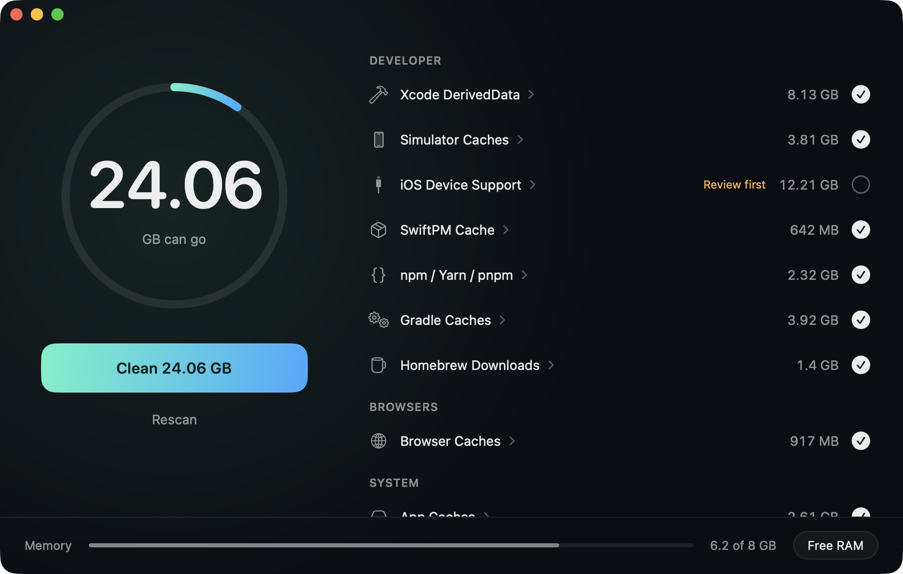

# FreeMyMacOS

A free, open-source macOS app that clears developer and app caches you can safely lose, and shows what is using your memory. Native SwiftUI, no accounts, no network.



*Screenshot shows sample data.*

## What it does

1. **Disk cleanup.** Scans a fixed list of cache folders, shows how much each one measures on disk, and deletes the contents of the ones you select. Every number shown is measured, never estimated.
2. **Memory panel.** Shows used and total memory, the five apps using the most memory with a **Quit** button for each (a normal quit, never a force quit), and **Free RAM**, which runs `/usr/sbin/purge` after asking for your administrator password.

That is all it does. There is no background scanning, no menu bar agent and no helper daemon.

Requires macOS 14 or later, on Apple silicon or Intel.

## Exactly what it cleans

Paths are relative to your home folder (`~`). For each one, the folder itself is kept and only what is inside it is deleted.

| Title | Tier | Folders (relative to `~`) |
|---|---|---|
| Xcode DerivedData | safe | `Library/Developer/Xcode/DerivedData` |
| Simulator Caches | safe | `Library/Developer/CoreSimulator/Caches` |
| iOS Device Support | careful | `Library/Developer/Xcode/iOS DeviceSupport` |
| Xcode Archives | careful | `Library/Developer/Xcode/Archives` |
| SwiftPM Cache | safe | `Library/Caches/org.swift.swiftpm` |
| npm / Yarn / pnpm | safe | `.npm/_cacache`, `Library/Caches/Yarn`, `Library/pnpm/store` |
| pip Cache | safe | `Library/Caches/pip` |
| CocoaPods Cache | safe | `Library/Caches/CocoaPods` |
| Gradle Caches | safe | `.gradle/caches` |
| Homebrew Downloads | safe | `Library/Caches/Homebrew` |
| Browser Caches | safe | `Library/Caches/Google/Chrome`, `Library/Caches/com.apple.Safari`, `Library/Caches/Firefox`, `Library/Caches/company.thebrowser.Browser` |
| App Caches | safe | `Library/Caches` (see exclusions below) |
| User Logs | safe | `Library/Logs` |
| Trash | careful | `.Trash` |

- **App Caches** skips every folder whose name starts with `com.apple.`, the app's own cache folder, and any folder that already belongs to another row above (`org.swift.swiftpm`, `Yarn`, `pip`, `CocoaPods`, `Homebrew`, `Google`, `Firefox`, `company.thebrowser.Browser`). That exclusion list is derived from the catalog in code, not written by hand.
- **safe** rows are selected by default. **careful** rows are not, and cleaning while one is selected asks for confirmation first.
- Folders for tools you do not have installed are simply hidden.
- Sizes are counted per path. Files that are hard-linked or cloned elsewhere (for example the pnpm store) are counted in full here, so the space a clean actually frees there can be smaller than shown.

The list lives in [`Sources/FreeMyMacOSCore/TargetCatalog.swift`](Sources/FreeMyMacOSCore/TargetCatalog.swift). The app never takes a path from you, so nothing outside this list can be deleted.

**Deleting is permanent.** Items are removed, not moved to the Trash (moving them to the Trash would not free any space).

## What it never touches

- Anything outside the folders above: your documents, photos, projects, app data, settings, keychains, mail and messages.
- System folders (`/System`, `/Library`, `/private`, ...) and other users' files. Everything it deletes is inside your own home folder.
- The folders in the table themselves. They are kept, only their contents go.
- Whatever a symbolic link points to. A link inside a cache folder is deleted as a link; its destination is never followed, measured or deleted.

### Safety design

- **SafetyGuard.** Every single deletion goes through `SafetyGuard.validate` first ([`SafetyGuard.swift`](Sources/FreeMyMacOSCore/SafetyGuard.swift)). It resolves real paths, compares them by whole path components, rejects `..`, refuses any allowed root that is your home folder or `~/Library` itself, refuses to delete a root itself, and fails closed whenever it cannot prove an item is strictly inside an allowed root.
- **Symlinks are never followed**, neither when measuring nor when deleting. A row folder that is itself a symbolic link is treated as missing.
- **Roots are kept.** Only items inside a root are removed.
- **Careful tier asks first.** Rows such as Xcode Archives and Trash are off by default and need a confirmation.
- **Partial failures are reported honestly.** A file that is in use or disappears is listed as a failure, the rest continue, and the freed total counts only what was actually deleted.
- **Full Disk Access is only needed for Trash and the Safari cache.** Without it those rows show "Grant access", which opens the Privacy settings page. The app never asks for it on its own, and everything else works without it.
- Tests never touch your real home folder; each one builds a fake home in a temporary folder.

## Privacy

FreeMyMacOS makes **no network requests** at all. There is no telemetry, no analytics, no crash reporting, no accounts, no license keys and no auto-update. Nothing about your files or your Mac leaves your computer.

## Build from source

Requires Xcode 26 or later (Swift 6.2).

```sh
git clone <this repository>
cd <repository folder>
swift build                      # compile
./Scripts/bundle.sh debug        # dist/FreeMyMacOS.app for this Mac only, signed ad hoc
./Scripts/bundle.sh release      # universal (arm64 + x86_64) dist/FreeMyMacOS.app, signed ad hoc
open dist/FreeMyMacOS.app
```

`bundle.sh` signs with the identity in `SIGN_ID` when it is set, and ad hoc otherwise, always with the hardened runtime and [`Support/FreeMyMacOS.entitlements`](Support/FreeMyMacOS.entitlements). The app is not sandboxed (it is distributed outside the Mac App Store).

The app icon is generated by [`Scripts/make-icon.swift`](Scripts/make-icon.swift); run `./Scripts/make-icon.sh` to rebuild `Support/AppIcon.icns`.

### Dry run

To see what a clean would free without deleting anything:

```sh
FMM_DRY_RUN=1 dist/FreeMyMacOS.app/Contents/MacOS/FreeMyMacOS
```

It scans your real folders, but **Clean** only measures and reports; nothing is removed.

### Mock mode

To work on the interface with fixed fake data that never reads or touches the disk:

```sh
FMM_MOCK=1 dist/FreeMyMacOS.app/Contents/MacOS/FreeMyMacOS
```

## Contributing

Issues and pull requests are welcome. Please keep the scope small: the app does disk cleanup and the memory panel, and nothing else.

```sh
swift test
```

All tests must pass, and any change to what can be deleted needs a test that runs against a fake home folder in a temporary directory. New cleanup targets must be added to `TargetCatalog` with fixed paths inside the home folder.

## Releasing

Releases are signed with a Developer ID Application certificate and notarized by Apple.

1. Once, store your notarization credentials in the keychain (it asks for an app-specific password):

   ```sh
   xcrun notarytool store-credentials <profile> --apple-id <you@example.com> --team-id <TEAMID>
   ```

2. Bump `CFBundleShortVersionString` and `CFBundleVersion` in `Support/Info.plist`.
3. Build, sign, package, notarize and staple:

   ```sh
   SIGN_ID="Developer ID Application: <Name> (<TEAMID>)" NOTARY_PROFILE=<profile> ./Scripts/notarize.sh
   ```

   This produces a universal, signed `dist/FreeMyMacOS.app` and a notarized, stapled `dist/FreeMyMacOS.dmg`. The DMG window layout comes from `Scripts/make-dmg.sh` (Finder may ask once for permission to arrange the window).
4. Attach `dist/FreeMyMacOS.dmg` to a release.

## License

[MIT](LICENSE)
